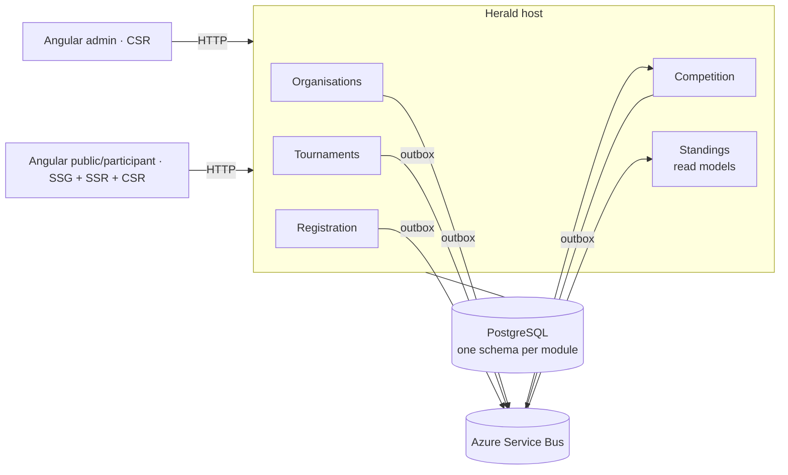

# Herald

  

Herald runs tournaments: it manages entries, prepares pairings, records effective results and publishes standings. Entries can represent individuals or teams. In a medieval tournament, announcing the competition was the herald's job.

It is game-agnostic: game-specific participation, scoring and tiebreakers are versioned policies. **H1 delivers an operator-run individual or direct-team round-robin league through web and API.** H2 adds discovery and participant self-service; H3 adds elimination and single match. [ADR 0013](docs/adr/0013-functional-delivery-scope.md) and the [roadmap](docs/roadmap.md) govern the delivery sequence.

It is also a reference: a small project that shows, end to end, how its maintainer builds .NET and Azure systems. Every decision is recorded in [`docs/adr/`](docs/adr/README.md), with the alternatives and the downsides, and the plan is in [`docs/roadmap.md`](docs/roadmap.md).

## Status

Pre-development design, with the M0 foundations implemented: the .NET solution, empty vertical-slice modules, PostgreSQL/host startup, messaging, architecture checks, CI and the web shells. `m0-messaging` (vertical-slice modules, Wolverine with the transactional outbox and inbox, the Service Bus emulator, pre-generated code) is implemented and archived. `m0-web-shell` is implemented and archived: the Angular workspace in [`web/`](web/README.md) with the admin (CSR) and public (SSG/SSR/CSR) shells, the `ui` library and its catalogue, both apps started through Aspire, and public/admin OpenAPI documents with their generated client, checked in CI. `h1-organisation-access` is implemented and archived: sign-in through the External ID directory shared with Arcana ([identity guide](docs/operations/identity.md)), organisation creation and switching, organisation isolation in the host and persistence, and the reviewed access states; it has been run against the real directory. End-to-end journeys ([`e2e/`](e2e/README.md), change `e2e-critical-paths`) run the composed system with a fake identity provider after each merge to `main`. `h1-tournament-setup` is implemented and awaits archival: an owner creates a draft tournament with a title, configures it, reviews it and publishes it, lists the organisation's tournaments and edits a published one; publication opens nothing, and registration, entries, competition and the public page do not exist. Architecture and product targets are not implementation claims.

The documentation baseline was consolidated on 7 November 2026. Detailed product policies remain explicitly confirmed or proposed in the functional decision ledger. The reviews and their original evidence are historical snapshots, tracked by the [consolidation change](openspec/changes/archive/2026-11-08-documentation-consolidation/design.md).

## Reading order

1. [Functional baseline and journeys](docs/herald-functional-discovery.md): vocabulary, scope, rules, decisions and acceptance examples.
2. [Roadmap](docs/roadmap.md): delivery order, implementation status and decision gates.
3. [Architecture decisions](docs/adr/README.md): rationale and target boundaries, especially [backend slices](docs/adr/0004-modular-monolith-with-vertical-slices.md) and [frontend features](docs/adr/0011-angular-front-end-and-generated-api-contract.md).
4. [Visual direction and state coverage](docs/herald-visual-direction.md): shared UI contracts, authoritative visual references and required review states.
5. [Domain presentation](docs/herald-domain-overview.pptx): explanatory companion to the same baseline.

Accepted specifications in `openspec/specs/` describe the implemented skeleton. Proposed deltas in `openspec/changes/` describe the next changes. Archived changes retain the historical structure they implemented.

## Visual direction

The [visual direction and design system](docs/herald-visual-direction.md) describes the shared foundations and the admin and public experiences, applying Refactoring UI. Review references:

- [Canonical individual outcomes and standings concept](docs/assets/mockups/herald-match-outcomes-and-standings.png)
- [Public discovery concept, H2](docs/assets/mockups/herald-tournament-discovery.png)
- [Interactive individual league prototype](prototypes/frontend/index.html)
- [Static H1 journeys: individual and direct-team leagues](prototypes/frontend/journeys.html)
- [H1 exception-state wireframes](prototypes/frontend/review-states.html)
- [Prototype usage and scope](prototypes/frontend/README.md)

These are design artefacts with sample data. The earlier round-management PNG is superseded for competitive semantics. Square geometry and exact state/token contracts come from the visual guide; neither image approval nor a working prototype implements production functionality.

## Architecture in four lines

- A **modular monolith**: one module per bounded context (Organisations, Tournaments, Registration, Competition, Standings initially), with **vertical slices for use cases**, a protected domain and module-owned persistence. Reuse follows responsibility; shared technical code does not automatically belong in Domain ([ADR 0004](docs/adr/0004-modular-monolith-with-vertical-slices.md)).
- **CQRS** inside each module, with commands and queries handled through **Wolverine** ([ADR 0005](docs/adr/0005-cqrs-with-wolverine.md)).
- **DDD with events**: aggregates guard the rules and raise domain events; modules talk only through integration events, stored in a **transactional outbox** and carried by **Azure Service Bus** ([ADRs 0006](docs/adr/0006-tactical-ddd-with-domain-events.md), [0008](docs/adr/0008-transactional-outbox-and-inbox.md), [0009](docs/adr/0009-azure-service-bus-through-wolverine.md)).
- Two **Angular** apps organised by functional feature over an API contract generated from OpenAPI: admin (CSR) and public/participant (SSG for corporate pages, SSR for dynamic public entry pages, CSR for personal workflows). They share presentation and API-client libraries, with explicit import and state-ownership boundaries ([ADRs 0011](docs/adr/0011-angular-front-end-and-generated-api-contract.md), [0012](docs/adr/0012-azure-hosting.md)).

The following diagram describes the target architecture; only the initial backend skeleton is implemented.

## How it is built

Production changes start as an [OpenSpec](https://github.com/Fission-AI/OpenSpec) proposal (`openspec/changes/`): specification, design, relevant visual states and tasks are reviewed before implementation. Significant decisions get an ADR. Domain rules are tested as sentences, for example `Starting_a_tournament_requires_at_least_two_eligible_entrants`; registration itself may close with fewer entries. Retrying the same operation returns its original receipt rather than creating a second effect.

## Stack (planned)

.NET 10 · ASP.NET Core · Wolverine · EF Core · PostgreSQL · Azure Service Bus · .NET Aspire · OpenTelemetry · xUnit · Testcontainers · Angular · TanStack Query · Vitest · Playwright · Azure Container Apps · Key Vault · Entra ID · OpenTofu · GitHub Actions

## Licence

The code is under the [MIT licence](LICENSE).
