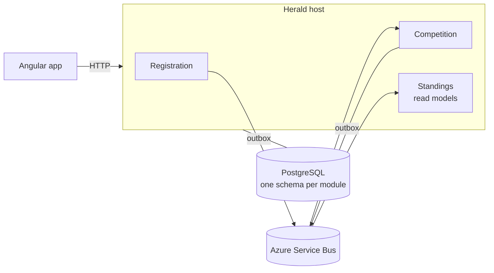

# Herald

  

Herald runs tournaments: it opens registration, pairs the players, collects the results and announces the standings. In a medieval tournament that was the herald's job.

It is game-agnostic. A league, a knockout bracket and a single match are the formats of v1. What changes from one game to another (whether a draw exists, how many points a win gives, how ties are broken) is a policy, not code.

It is also a reference: a small project that shows, end to end, how its maintainer builds .NET and Azure systems. Every decision is recorded in [`docs/adr/`](docs/adr/README.md), with the alternatives and the downsides, and the plan is in [`docs/roadmap.md`](docs/roadmap.md).

## Status

Design. The first ADRs are proposed and nothing is built yet. See [the roadmap](docs/roadmap.md).

## Architecture in four lines

- A **modular monolith**: one module per bounded context (Registration, Competition, Standings), each one **hexagonal**: the domain at the centre, ports around it, adapters at the edge ([ADR 0004](docs/adr/0004-modular-monolith-of-hexagonal-modules.md)).
- **CQRS** inside each module, with commands and queries handled through **Wolverine** ([ADR 0005](docs/adr/0005-cqrs-with-wolverine.md)).
- **DDD with events**: aggregates guard the rules and raise domain events; modules talk only through integration events, stored in a **transactional outbox** and carried by **Azure Service Bus** ([ADRs 0006](docs/adr/0006-tactical-ddd-with-domain-events.md), [0008](docs/adr/0008-transactional-outbox-and-inbox.md), [0009](docs/adr/0009-azure-service-bus-through-wolverine.md)).
- An **Angular** front end over an API contract generated from OpenAPI, deployed to **Azure Container Apps** with OpenTofu ([ADRs 0011](docs/adr/0011-angular-front-end-and-generated-api-contract.md), [0012](docs/adr/0012-azure-hosting.md)).

## How it is built

Every change starts as an [OpenSpec](https://github.com/Fission-AI/OpenSpec) proposal (`openspec/changes/`): the specification, the design and the tasks are reviewed before any code is written, and the accepted specifications live in `openspec/specs/`. Decisions that are hard to reverse get an ADR. Domain rules are tested as sentences (`Closing_registration_fails_when_fewer_than_two_players_registered`).

## Stack (planned)

.NET 10 · ASP.NET Core · Wolverine · EF Core · PostgreSQL · Azure Service Bus · .NET Aspire · OpenTelemetry · xUnit · Testcontainers · Angular · TanStack Query · Vitest · Playwright · Azure Container Apps · Key Vault · Entra ID · OpenTofu · GitHub Actions

## Licence

The code is under the [MIT licence](LICENSE).
